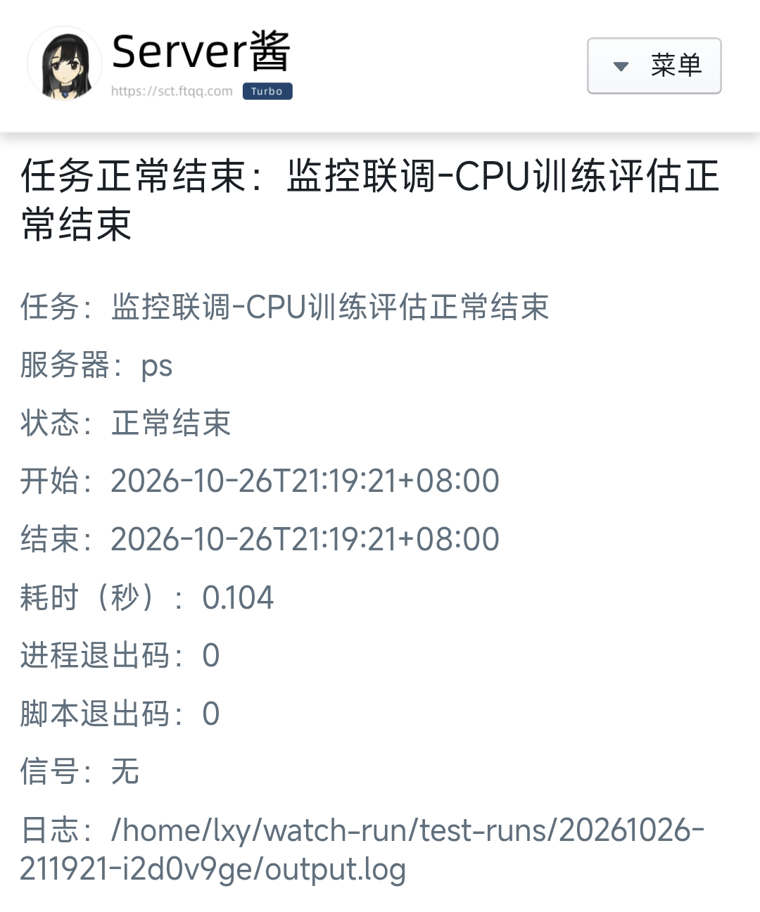
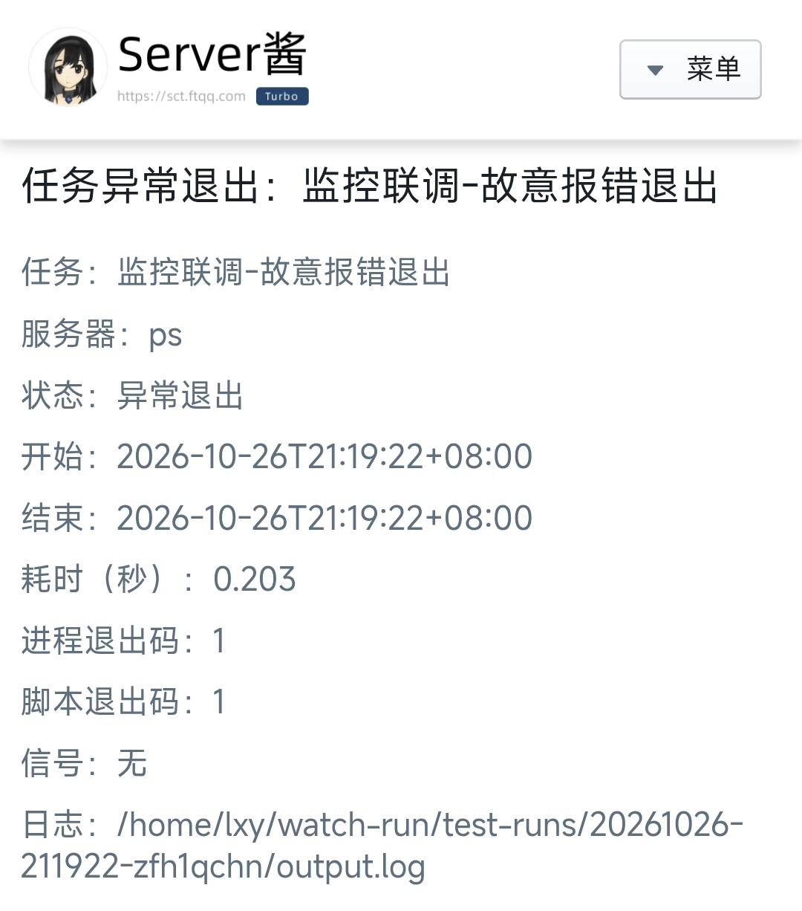
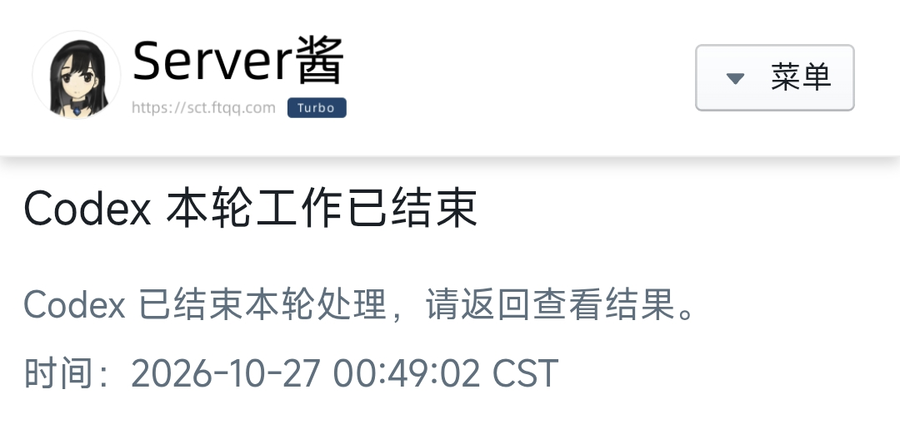

# RunChime 🔔

[English](README.md) | **简体中文**

**训练结束、评估退出、Codex 回复完成，把提醒发到微信。**

RunChime 是一个轻量的 Python 命令行工具，通过 **Server酱 Turbo** 发送通知。无需修改训练代码，无第三方运行时依赖。

| 场景 | 命令 | 能判断什么 |
| --- | --- | --- |
| 启动新的训练、评估或脚本 | `runchime run` | 正常结束、非零退出、信号终止、超时 |
| 任务已经在运行 | `runchime attach --pid PID` | 指定进程已退出；不能可靠取得退出码 |
| 任务疑似停滞预警 | `run / attach --stall-after` | 进程树 CPU、I/O、日志及相关 NVIDIA GPU 持续低活动 |
| Codex 主对话一轮结束 | `runchime codex install` | `Stop` 事件；忽略子代理和旧通知事件 |

支持 Linux、Python 3.8+。附加模式依赖 Linux `/proc`；目前不提供 Windows 支持。GPU 任务不需要额外依赖：RunChime 监控进程，不占用 GPU。

## 通知效果

通过 Server酱发送、在微信中打开的通知详情。前两张来自短时测试任务，第三张展示 Codex 主对话本轮结束的提醒。点击图片可放大查看。

<table>
  <tr>
    <th>任务正常结束</th>
    <th>任务异常退出</th>
    <th>Codex 本轮结束</th>
  </tr>
  <tr>
    <td width="33%" valign="top" align="center">
      <a href="docs/images/task-success.png"></a>
    </td>
    <td width="33%" valign="top" align="center">
      <a href="docs/images/task-failure.png"></a>
    </td>
    <td width="33%" valign="top" align="center">
      <a href="docs/images/codex-turn-ended.png"></a>
    </td>
  </tr>
  <tr>
    <td valign="top">退出码为 <code>0</code>，包含耗时和日志位置。</td>
    <td valign="top">退出码为 <code>1</code>，包含耗时和日志位置。</td>
    <td valign="top">表示主对话本轮已结束，不代表整个项目已完成。</td>
  </tr>
</table>

## 快速开始

### 1. 安装

```bash
git clone https://github.com/Czyl9323/RunChime.git
cd RunChime
python3 -m venv ~/.venvs/runchime
~/.venvs/runchime/bin/python -m pip install .
export PATH="$HOME/.venvs/runchime/bin:$PATH"
```

要让后续终端也能找到命令，可以将最后一行加入 `~/.bashrc` 或 `~/.zshrc`。安装环境无需包含 PyTorch；被监控的 `python`、`torchrun` 等命令仍从当前 shell 的环境中查找。先激活你的训练环境，再运行 RunChime 即可。

也可使用已有的 pipx：`pipx install .`。项目尚未发布到 PyPI，请从本仓库安装。

### 2. 配置你自己的 Server酱密钥

1. 打开 [Server酱 Turbo 官网](https://sct.ftqq.com/)，按服务商指引配置微信接收渠道，取得 **SCT 开头的 SendKey**。
2. 在**实际运行任务或 Codex 的机器和账号下**执行：

```bash
runchime configure
```

按提示输入自己的 SendKey，输入不会回显。密钥默认保存为 `~/.config/runchime/serverchan.key`，权限为 `0600`。仓库不提供共享密钥，也不需要你把密钥填写到源码里。

```bash
runchime doctor   # 只检查本地配置，不发送微信
runchime test     # 发送一条配置测试通知，会使用服务商额度
```

已有文件不会被静默覆盖；更换密钥使用 `runchime configure --force`。不要把密钥发到 Issue、提交到 Git，或直接放进 shell 命令历史。`.gitignore` 已排除密钥、日志、运行状态及备份文件。

### 3. 启动任务

```bash
runchime run --name "模型训练" -- python -u train.py
runchime run --name "模型评估" -- bash -o pipefail evaluate.sh
```

`--` 后面是原来的命令和参数。任务输出写入日志；启动时会打印日志及结果路径。任务结束后发送一条通知，RunChime 返回任务退出码。

## 常见用法

### 后台运行，断开 SSH 后继续

```bash
nohup runchime run --name "实验 A" \
  --log-dir "$HOME/run-logs" \
  -- python -u train.py --epochs 100 \
  > monitor.log 2>&1 &

echo $!  # RunChime 监控进程的 PID
```

也可以在 `tmux` 内使用。被包装的训练脚本应保持前台运行，内部不要再次用 `nohup`、`&` 或其他方式将实际任务脱离出去。分布式训练包装 `torchrun` 等启动器，而不是单个 worker。

需要管道或重定向时，显式使用 shell，并开启 `pipefail`，避免训练失败但管道最后一个命令返回成功：

```bash
runchime run --name "训练流水线" -- \
  bash -o pipefail -c 'python -u train.py | tee train.log'
```

### 附加到已经运行的进程

找到训练启动器或评估进程的 PID，然后运行：

```bash
nohup runchime attach --name "已有训练" \
  --pid 12345 \
  --task-log /path/to/train.log \
  > monitor-12345.log 2>&1 &
```

将 PID 和路径替换为你的实际值。`--task-log` 可省略，只记录原日志位置，不读取、修改日志或据此猜测训练是否成功。

- 进程退出后通知 **“进程已退出，结果未知”**，结果里的 `returncode` 为 `null`。
- 监控脚本此时返回 `0`，表示观察完成，**不表示训练成功**。
- PID 与进程启动时间一起校验，避免 PID 被其他进程复用后继续误监控。
- 停止监控、收到终止信号或达到监控超时，都不会向原任务发送终止信号。
- 只跟踪所选进程；它退出后仍存活的子进程不在附加模式的观察范围内。

需要准确知道成功或失败时，下一次使用 `runchime run` 启动任务。

### 任务疑似停滞预警（30 分钟）

添加 `--stall-after` 启用预警；不写秒数时，阈值为 **30 分钟（1800 秒）**。该功能默认不开启，已有命令的行为保持不变。

```bash
# 持续低活动达到 30 分钟时提醒，任务继续运行
runchime run --name "模型训练" --stall-after -- python -u train.py

# 附加到已有任务；提供日志时也会检查日志活动
runchime attach --name "已有训练" --pid 12345 \
  --task-log /path/to/train.log --stall-after

# 自定义阈值，单位秒
runchime run --name "模型评估" --stall-after 900 -- python -u eval.py
```

**不是只看日志有没有更新。** RunChime 默认每 10 秒采样一次（可用 `--stall-interval` 调整），检查目标进程及可见子孙进程，只有以下条件持续满足才预警：

- 进程树累计 CPU 使用率低于单核的 1%。
- 进程 I/O 字节计数没有变化，包括缓存读写。
- 如果有被观察的日志，其元数据没有变化。启动模式观察 `output.log`；附加模式在提供 `--task-log` 时观察该日志。不读取日志内容。
- 进程树所关联的 NVIDIA GPU 没有设备利用率，或目标进程树没有 NVIDIA 计算进程。通过 `nvidia-smi` 读取指标；仅占用显存不代表还在计算。

检测到任意活动都会重置计时。进程/I/O/日志指标缺失、GPU 查询失败或返回 `N/A` 时，记为**未知**而非零，会中断静默窗口并抑制停滞预警。最新指标及原因记录在 `result.json` 的 `stall_monitor` 中。未检测到 NVIDIA 驱动/工具时，使用 CPU、I/O 和可用的日志活动；不支持非 NVIDIA 加速器利用率检测。

同一次持续低活动只尝试提醒一次，发送失败也不重试；恢复活动后再次进入低活动状态，才可能产生下一次预警。预警不会终止任务或改变退出码，最终结束通知仍独立发送。`--no-notify` 会在本地记录预警，但不发微信。通知请求在后台执行，网络慢不会耽误任务超时处理或终止信号转发。

通知明确写“**疑似停滞**”，不直接判定任务失败。正常等待也可能低活动；死循环或持续打印日志的程序可能没有实际进展，却看起来仍活跃。共享 GPU 上其他任务的活动可能抑制预警；容器 PID 可见性、短命子进程、非 NVIDIA 加速器和驱动指标支持情况也会影响检测。它是低活动启发式预警，不能证明死锁，也不能代替业务进度或心跳检查。此功能用于任务监控，不用于 Codex 对话。

### 超时与离线检查

```bash
# 启动模式：1 小时后终止任务；宽限 10 秒后必要时强制终止
runchime run --name "限时评估" --timeout 3600 --kill-after 10 -- python eval.py

# 附加模式：1 小时后只停止监控，任务继续运行
runchime attach --name "观察训练" --pid 12345 --timeout 3600

# 不访问 Server酱，不需要密钥
runchime run --name "离线测试" --no-notify -- python -c 'print("hello")'
```

附加模式可用 `--interval 5` 调整检查间隔，默认 1 秒。所有参数可通过 `runchime run --help`、`runchime attach --help` 查看。

## Codex 完成通知

### 安装 Stop Hook

先完成密钥配置，再运行：

```bash
runchime codex install
```

安装器将 RunChime 处理器合并进 `$CODEX_HOME/hooks.json`，未设置 `CODEX_HOME` 时使用 `~/.codex/hooks.json`。保留其他 Hook；修改已有文件前创建带时间戳的备份；重复安装不会增加重复处理器。Hook 使用当前 Python 和安装位置的绝对路径，不依赖 Codex 会话的工作目录或 PATH。

**重新启动 Codex，运行 `/hooks` 审查并信任新 Hook。** 安装或更新配置不会自动取得信任。移动或删除 RunChime 的安装环境后，需要重新安装 Hook。

本项目沿用 Codex CLI 0.163.0 的 Stop Hook 方案。不同版本或客户端的事件路由可能不同，请按下述流程实际联调。官方说明见 [Codex Hooks](https://learn.chatgpt.com/docs/hooks)。

### 从旧 `notify_wechat.py` 迁移

```bash
runchime codex install --migrate-legacy
```

此选项会：

1. 备份并移除用户 `hooks.json` 中调用 `notify_wechat.py` 的旧处理器。
2. 将用户 `config.toml` 中可识别的**单行、顶层**旧 `notify = [...]` 注释掉。
3. 只安装 RunChime 的 `Stop` 处理器，不注册 `SubagentStop`。

复杂或多行旧 `notify` 配置需要手动处理；安装器不会猜测修改。项目级 Hook、内联 `[hooks]` 和其他插件不在自动迁移范围内，请检查是否存在重复通知。原来的 `serverchan.key` 可以继续使用，见下方密钥查找顺序。

### 验证与卸载

下面的测试不发微信：

```bash
printf '%s' '{"hook_event_name":"SubagentStop","agent_id":"test-child"}' \
  | python -m runchime codex-hook
```

预期输出 `{}`。然后让 Codex 执行一个明确包含子代理的任务：子代理结束时不通知，主对话结束本轮时通知一次。

```bash
runchime codex uninstall
```

卸载只移除 RunChime Hook，保留密钥、去重记录及其他处理器；不会重新启用已停用的旧 `notify`。

### 事件语义

- 只处理 `Stop`；忽略 `SubagentStop`、旧 `agent-turn-complete` 以及其他事件。
- 相同 `session_id + turn_id` 最多提交一次。去重状态位于 `$CODEX_HOME/wechat-notify-state/`，兼容旧脚本。
- `Stop` 是**主对话一轮结束**，不保证项目成功。Goal 自动续跑、多轮交互仍可能每轮通知；其他 Stop Hook 要求继续工作时，通知也可能早于整个工作流完成。
- 发送前写入去重标记。网络超时、进程中断或服务商拒绝后不重试；因此宁可漏发，也不因重复事件再次提交。
- 不要在运行中删除去重记录。通知失败只返回 `systemMessage`，不要求 Codex 继续工作。

## 配置与结果

密钥按以下顺序查找；选中的文件无效时直接报错，不静默换用其他账号：

1. 当前命令的 `--key-file /path/to/serverchan.key`（任务监控、doctor、test）。
2. 环境变量 `RUNCHIME_KEY_FILE` 指定的文件。
3. `$RUNCHIME_HOME/serverchan.key`；未设置时为 `$XDG_CONFIG_HOME/runchime/serverchan.key`，默认 `~/.config/runchime/serverchan.key`。
4. 兼容旧配置：`$CODEX_HOME/serverchan.key`，默认 `~/.codex/serverchan.key`。

`configure --key-file PATH` 指定**写入位置**；之后使用该文件时也需设置 `--key-file` 或 `RUNCHIME_KEY_FILE`。使用自定义环境变量安装 Codex Hook 后，启动 Codex 时也要保留对应环境变量。新服务器不会自动同步密钥，需要在该服务器上重新配置。

每次监控在 `logs/runchime/` 下创建独立目录，也可通过 `--log-dir` 指定：

```text
logs/runchime/<时间戳>-<随机后缀>/
├── output.log   # 启动模式：任务 stdout/stderr；附加模式：监控记录
└── result.json  # 状态、退出码、PID、耗时、日志位置、通知提交状态及可选的停滞预警历史
```

| 结果 | 含义 |
| --- | --- |
| `succeeded` / `failed` | 启动任务返回 0 / 非零 |
| `terminated` / `interrupted` | 任务被信号终止 / 启动模式监控收到终止信号 |
| `timed_out` | 启动任务超时，脚本返回 124 |
| `launch_failed` | 未能启动任务，脚本返回 127 |
| `exited_unknown` | 附加目标退出，任务退出码未知 |
| `monitor_stopped` / `monitor_timed_out` | 附加监控停止，原任务未被终止 |
| `attach_failed` / `observation_failed` | 无法附加或读取状态，脚本返回 2 |

通知的 `accepted` 仅表示 Server酱受理；`unknown` 表示网络失败或响应不明确；`rejected` 表示未返回成功码。任务退出状态与通知状态分别记录，通知失败不覆盖任务退出码。缺少密钥时仍会运行任务，但记录 `configuration_error`，建议先执行 `runchime doctor`。

## 隐私与边界

- **任务通知**发送任务名、主机名、时间、状态、退出码、日志路径；附加模式还包含目标 PID。不会上传命令参数、代码或日志内容。请勿在任务名里填写敏感信息。
- **停滞预警**还包含低活动持续时间及采样的 CPU、I/O、日志变化和 GPU 指标，不包含日志内容。
- **Codex 通知**只发送固定提示与时间，不上传提示词、代码或最后一条回复。
- 发送使用 HTTPS，无自动网络重试。服务商额度、渠道及微信接收设置由用户自行管理。
- 服务器断电、监控自身被 `SIGKILL`、网络断开等场景不能保证提醒，需要另一台机器上的心跳监控。
- 返回 0 仅代表进程正常退出，无法识别被程序吞掉的异常，也不保证模型质量或产物完整性。

## 开发与测试

```bash
python -m unittest discover -s tests -v
```

测试使用临时目录、虚拟密钥和模拟网络，不读取开发者的真实密钥，不发送微信。覆盖任务退出、信号、超时、附加监控、PID 复用、Codex 过滤与并发去重、密钥配置、Hook 合并与迁移、多指标停滞预警（含模拟的 30 分钟时间窗口）。GitHub Actions 会在多版本 Python 上运行这些测试。

源码模式无需安装即可试用：`python -m runchime --help`。兼容入口仍保留为 `scripts/watch_run.py` 和 `scripts/notify_wechat.py`。

欢迎通过 [Issues](https://github.com/Czyl9323/RunChime/issues) 提交问题；请移除密钥及私人日志后再附上诊断信息。

## License

[MIT](LICENSE)
